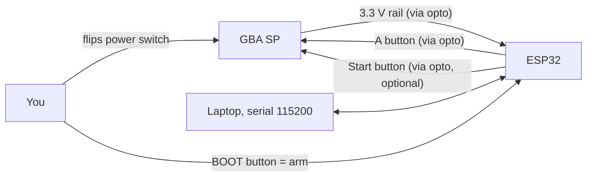
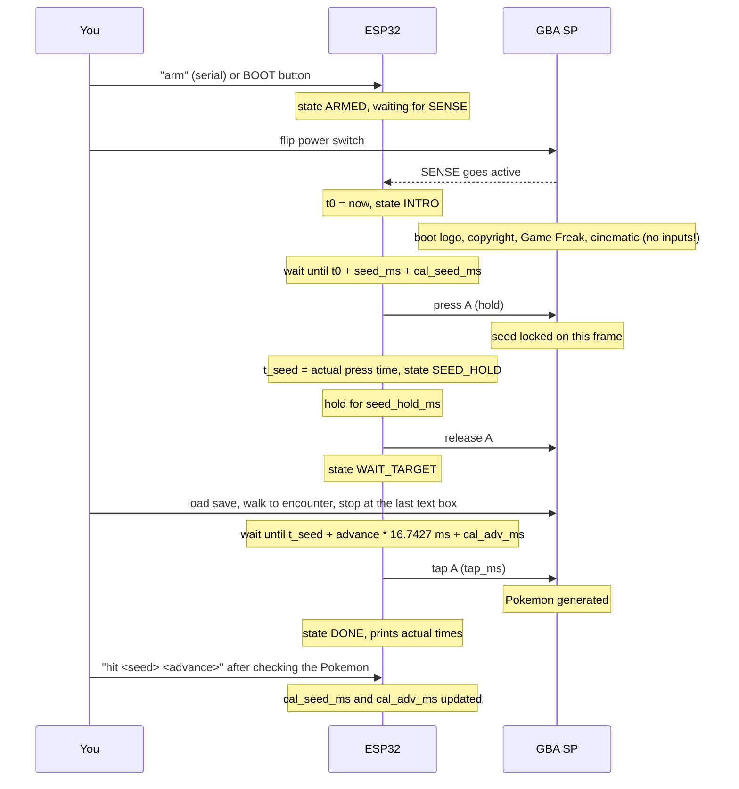
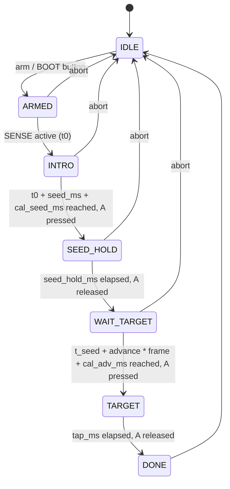

# 02. System design

> This is the original design for FireRed / LeafGreen, with a seed press on the title screen. The firmware implements simpler versions of its state machine and calibration. FireRed / LeafGreen as actually done on hardware, with precomputed seed tables and a calibration per spot, is in [07-firered-leafgreen.md](07-firered-leafgreen.md); Emerald is in [06-emerald.md](06-emerald.md).

## Goal

Turn one power-cycle of the SP into a deterministic sequence of button presses, timed from the moment the console powers on, with a correction mechanism that converges after one or two misses.

## Components



Three signals cross between the two devices, all through optocouplers:

| Signal | Direction | Purpose |
|---|---|---|
| SENSE | SP to ESP32 | SP powered on. Defines t0. |
| A | ESP32 to SP | Seed press (held) and target press (tap) |
| START | ESP32 to SP | Optional. Alternative seed button, future use |

## Timeline of one attempt



## State machine



Abort always releases every button first.

## Timing model

All times are measured with the ESP32's 64-bit microsecond timer (`esp_timer_get_time()`), which is derived from the 40 MHz crystal. Drift is on the order of 10 ppm, so under 1 ms over 100 s. Negligible against the 16.7 ms frame.

```
t0        = moment SENSE becomes active
t_seed    = t0 + seed_ms + cal_seed_ms
t_target  = t_seed + advance * FRAME_MS + cal_adv_ms

FRAME_MS  = 1000 / 59.7275 = 16.7427
```

`t_target` is computed from the *actual* seed press time, not the planned one, so a late seed press does not shift the target.

### Where the error comes from

| Source | Size | Handled by |
|---|---|---|
| SENSE detection vs. CPU actually starting | fixed, sub-ms | cal_seed_ms (constant offset) |
| Intro length | fixed per version/language/settings | cal_seed_ms |
| ESP32 scheduling jitter | under 50 us | spin-wait on the microsecond timer |
| Optocoupler switching | 3 to 20 us | nothing needed |
| GBA reads input once per frame | up to 16.7 ms quantisation | aim for the middle of the frame window |
| Save load, menus between seed and target | none, RNG advances per frame regardless | nothing needed |

The only unknowns are two constant offsets, which is exactly what the two calibration values are for.

### Aiming for the middle of the frame

Once calibration is correct, the press lands somewhere inside a 16.7 ms window. If it lands near the edge, timer drift or jitter flips it to the neighbouring frame now and then. After calibration converges, nudge `cal_seed_ms` in 2 ms steps and watch which values still hit. Pick the centre of the range that hits.

## Calibration math

After an attempt you look up which seed and advance you actually hit (PokeFinder or the Ten Lines calibration tool, see doc 05). The device then corrects itself:

```
delta_seed_frames = target_seed - hit_seed            (16-bit, wraps)
cal_seed_ms      += delta_seed_frames * FRAME_MS

delta_adv_frames  = target_advance - hit_advance
cal_adv_ms       += delta_adv_frames * FRAME_MS
```

Sign check: hit seed lower than target means the press came too early, so time is added. Same for advance.

Seeds in FRLG increase by about one per frame after the intro, so a seed difference converts directly to frames. If the seed difference is large (hundreds), the first correction may overshoot slightly because the "about one per frame" is not exact. A second attempt normally lands.

## Design decisions and rejected alternatives

| Decision | Alternative | Why rejected |
|---|---|---|
| Sense power-on via the 3.3 V rail | Have the device perform a soft reset as t0 | Soft reset does not reset the seed timer in FRLG (see doc 01) |
| Sense power-on via the 3.3 V rail | Have the device switch the SP power | Needs intrusive mod of the battery path. Possible later. |
| Sense power-on via the 3.3 V rail | Light sensor on the screen | Backlight timing relative to CPU start is unknown, adds jitter |
| Optocouplers | MOSFETs / NPN transistors | Would need a shared ground between USB-powered ESP32 and battery-powered SP. Works, but a wiring mistake can put 5 V on the SP's logic. Isolation costs 50 cents per channel. |
| Optocouplers | Servos pressing the buttons | Mechanical jitter is larger than one frame |
| Serial control for v1 | OLED + encoder from day one | Serial gets to a calibrated, working device fastest. UI is v2. |
| Two output channels (A, Start) | All eight buttons | Only A is required. Start is a spare seed button. More channels means more solder joints on old pads. |
| Timed from actual seed press | Timed from t0 for both | Decouples target error from seed error |

## Prior art

[GBAFrameSyncer](https://github.com/i-decosmis/GBAFrameSyncer) (GPL-3.0) automates Emerald manipulation on a GBA SP with an Arduino Nano, four PC817 optocouplers and 220 ohm resistors, which validates the hardware side of this design. It differs where the games differ: Emerald has a fixed seed, so it soft-resets the console as t0 and runs a single timer. FRLG needs power-on sensing and two timers (see doc 01). Two things we deliberately do differently: button presses last 50 ms instead of 15 ms, because 15 ms is shorter than one frame and can fall between two input reads, and timing uses the ESP32's 64-bit microsecond clock instead of Arduino `micros()`, which overflows after 70 minutes.

## Out of scope for v1

- Automatic power cycling
- Detecting the title screen or the encounter screen (camera or light sensor)
- Multi-step programmable sequences
- Standalone UI (planned as v2)
