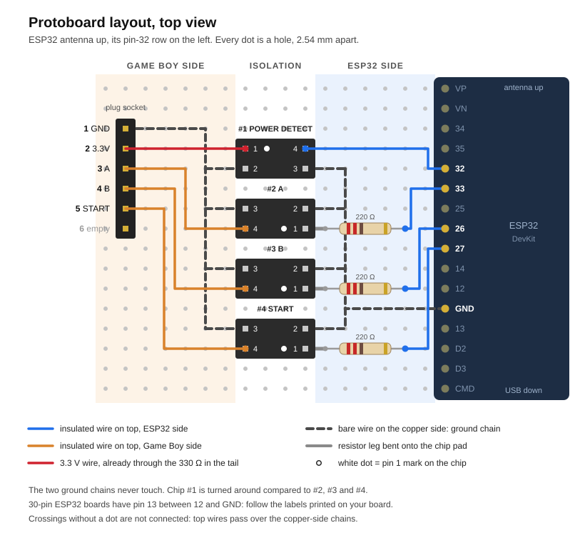
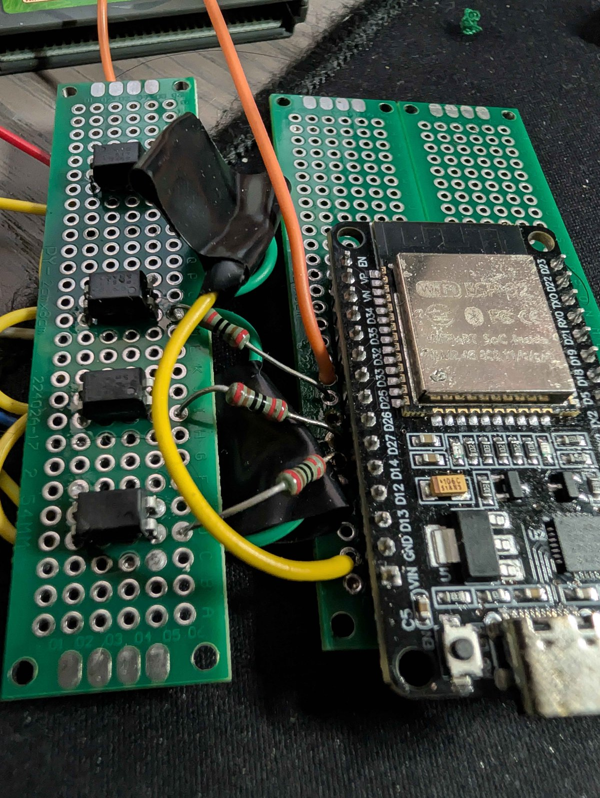
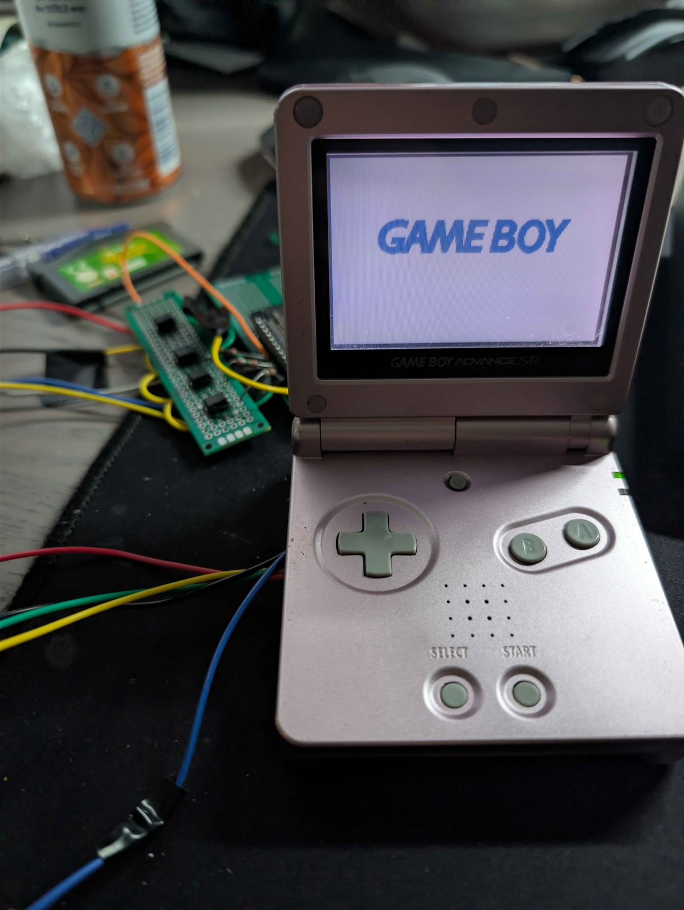
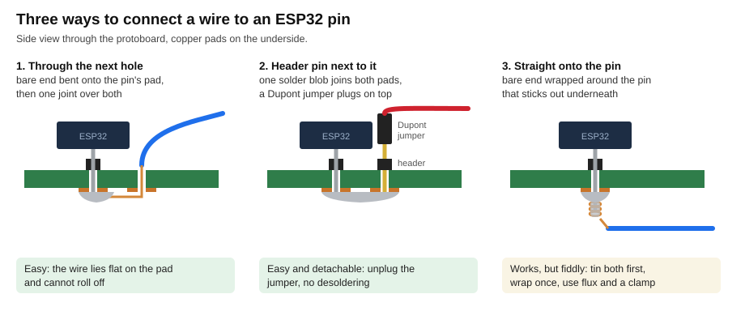

# 03. Hardware

## Overview

Two electrically separate domains, joined only by optocouplers:

- **ESP32 domain**: ESP32 DevKit, powered from USB (laptop or power bank). Ground = USB ground.
- **SP domain**: the console, powered from its own battery. Ground = SP ground.

Nothing connects the two grounds. This is deliberate.

## Bill of materials

| Qty | Part | Note |
|---|---|---|
| 1 | ESP32 DevKit (any 30/38-pin WROOM board) | on hand |
| 4 | PC817 optocoupler (DIP-4) | or EL817, LTV-817. Buy a 10-pack, they are cheap. |
| 3 | 220 ohm resistor | LED current limit for the A, B and Start channels |
| 1 | 330 ohm resistor | LED current limit for the SENSE channel. Sits in the SP's 3.3 V wire before the plug, see below. |
| 1 | protoboard | on hand |
| 2 | 2.54 mm female header strip | optional, keeps the ESP32 removable |
| 1 m | 30 AWG wire-wrap wire or enamelled wire | the thinner the better inside the SP |
| 1 | 6-pin Dupont (2.54 mm) housing with female crimp contacts | the plug on the SP tail. A Dupont assortment kit covers it. |
| 1 | 1x6 male pin header, 2.54 mm | the socket for that plug on the protoboard |
| a few cm | heat shrink tubing, 1.5 to 3 mm | insulates the inline resistor. Kapton or electrical tape works too. |
| 1 | tri-point Y0 driver | the six bottom shell screws |
| 1 | JIS 00 driver, or a Phillips #00 used carefully | battery cover screw and the three board screws. JIS heads strip easily under a regular Phillips: press firmly, turn slowly. |
| 1 | 0.96" SSD1306 OLED, I2C | v2, on hand |
| 1 | rotary encoder module (KY-040) | v2, on hand |

## Schematic

PC817 pinout, looking at the top with the dot or notch at the top left:

```
        ┌───∪───┐
 anode  1●      4  collector
cathode 2       3  emitter
        └───────┘
```

Internally pin 1 to 2 is an infrared LED, pin 4 to 3 is a phototransistor. Light from the LED turns the transistor on. No electrical connection between the two sides.

### Output channels: A, B and Start

```
ESP32 domain                         PC817                        SP domain

GPIO 33 (A) ───[ 220R ]─── 1 ●───►├──── 4 ──────────────── TP0  (A button line)
                                  │
ESP32 GND ───────────────── 2 ────┘    3 ──────────────── SP GND
```

B (GPIO 26 to TP1) and Start (GPIO 27 to the Start via) are identical copies of this channel.

Operation: GPIO high drives about 9.5 mA through the LED ((3.3 V - 1.2 V) / 220). The phototransistor pulls the button line to SP ground, which is exactly what the rubber button does when pressed. GPIO low = button released.

Why it works electrically: each button line in the SP is pulled up to the 3.3 V I/O rail by the CPU. A pressed button shorts it to ground. The PC817 transistor saturates at under 0.2 V with the few hundred microamps the pull-up supplies, which reads as a clean logic low.

### SENSE channel (SP power detection)

```
SP domain                            PC817                        ESP32 domain

SP 3.3 V rail ───[ 330R ]── 1 ●───►├──── 4 ──────────────── GPIO 32 (INPUT_PULLUP)
                                   │
SP GND ──────────────────── 2 ─────┘    3 ──────────────── ESP32 GND
```

Operation: when the SP is on, its 3.3 V rail drives about 6 mA through the LED. The transistor pulls GPIO 32 low. SP off = GPIO 32 high (internal pull-up). The firmware takes t0 on the high-to-low edge.

The 330 ohm value keeps the extra load on the SP regulator under 7 mA, which is nothing next to the backlight.

**The 330 ohm resistor sits in the SP's 3.3 V wire, before the plug**: inside the shell close to its solder point, or in the tail just outside the notch, insulated with heat shrink. Electrically it does the same job anywhere in the loop. At the SP end it also limits the current of the only powered wire that leaves the console, so a short anywhere in the cable, the plug or on the protoboard draws at most 10 mA. The other wires are button lines and ground: shorting them just presses a button.

### Complete pin map

| ESP32 GPIO | Function | Direction | Note |
|---|---|---|---|
| 32 | SENSE (SP power) | in, pull-up | via optocoupler #1, active low |
| 33 | A button | out | via optocoupler #2. GPIO 25 works too: the reference build moved A to 33 after damaging the 25 pad. |
| 26 | B button | out | via optocoupler #3 |
| 27 | Start button | out | via optocoupler #4 |
| 14 | Select button | | reserved, not used by the current firmware |
| 21 / 22 | OLED SDA / SCL | I2C | v2 |
| 13 / 4 / 23 | encoder CLK / DT / SW | in | v2 |

Pins avoided on purpose: 6 to 11 (flash), 12 and 15 (boot strapping), 34 to 39 (input only, no pull-ups).

## Connections inside the SP

Five wires leave the console: GND, 3.3 V, A, B and Start. One ground is enough, the SP-side pins of all optocouplers tie to it on the protoboard. Select can be added as a sixth wire, but read the soldering notes first.

### Test points

The SP main board has labelled test points for every button. Reported labels, matching the original GBA numbering:

| Button | Test point |
|---|---|
| A | TP0 |
| B | TP1 |
| Select | TP2 |
| Start | TP3 |
| Right / Left / Up / Down | TP4 / TP5 / TP6 / TP7 |
| R / L | TP8 / TP9 |

Confirmed for the SP by the board photo in the [GBAFrameSyncer](https://github.com/i-decosmis/GBAFrameSyncer) project (board marking C/AGT-ECPU-01). On that board TP0 sits just above and to the right of the A dome, and TP1 just above and to the right of the B dome, between B and A. Select and Start are two adjacent vias just above the Start switch SW7, Select on the left. A usable GND pad is top left, next to the P5 header. That project uses the same optocoupler approach and reports it working.

**Still verify before soldering.** Board revisions differ. Put a multimeter on continuity between the candidate test point and the button's non-ground contact pad. Each button has two interleaved contacts under the rubber dome; one is ground (continuity to the metal shielding or the battery negative), the other is the signal line. Solder only to the signal line.

If the labels on your board revision differ, continuity testing finds the right via anyway. Never solder on the gold button contacts themselves: the rubber dome must sit flat on them.

### 3.3 V and ground

- 3.3 V: candidates are the test pad labelled VCC above the Select switch, or the cartridge slot VCC pin itself. The board cannot be powered while it is out of the shell, so identify the point by continuity: it must beep against pin 1 (VCC) of the cartridge slot, which the console switches with its power switch. Pin 32 at the other end of the slot beeps steadily against ground. The battery pad BT+ is the wrong point: it is the battery itself, stays live when the console is off, and SENSE would never see a power-on edge. The on/off behaviour is confirmed by measuring the plug before the shell is closed. In Game Boy Color mode the cartridge VCC carries 5 V, which the 330 ohm resistor also handles at under 12 mA.
- GND: the pad top left next to the P5 header, any large ground pad, the metal shield, or the cartridge connector GND (pin 32).

### Getting the wires out: notch and plug

The shell has no spare opening, so one gets cut: a notch of about 3 mm in the side wall on the power-switch side, between the shoulder button and the switch. GBAFrameSyncer cut its opening in the same spot.

The five wires leave through the notch as a twisted tail of 10 to 15 cm, hot-glued at the notch for strain relief. The tail ends in a 6-pin Dupont (2.54 mm) housing with female crimp contacts, so nothing conductive is exposed when it is unplugged. The protoboard has a matching 1x6 male pin header. Normal play means unplugging the tail, and the console then plays as stock with a short pigtail.

| Plug pin | Wire | SP board point |
|---|---|---|
| 1 | GND | pad top left, next to the P5 header |
| 2 | 3.3 V, already through the 330 ohm resistor | pad with continuity to cartridge slot pin 1 |
| 3 | A | TP0 |
| 4 | B | TP1 |
| 5 | Start | right one of the two vias above the Start switch |
| 6 | Select, optional | left one of the two vias above the Start switch |

The order mirrors the ESP32 header (32, 33, 26, 27, 14), which keeps the protoboard wiring straight. Mark pin 1 on the housing.

Dupont housings are not keyed, so the plug fits both ways round. That is harmless in this circuit: every SP-side line is ground, a pulled-up button line or the current-limited 3.3 V, so a reversed or shifted plug only makes things not work.

Crimping 30 AWG: the contacts are made for thicker wire. Strip 5 mm, fold the bare end back double, close the tabs with pliers and add a dab of solder.

A connector glued into the shell wall was considered. It needs 11 to 14 mm of depth behind the wall, so the tail is the simpler choice.

The optocouplers are open circuit when the ESP32 is unpowered, so the console also plays as stock with the protoboard plugged in.

### Soldering notes

- 30 AWG wire, tin the wire first, then touch it to the pre-tinned test point for under one second. The pads lift if heated long.
- Flux helps. Lead-free solder at 350 C, leaded at 320 C. If solder does not flow within 2 seconds, add flux instead of heat.
- **The Start and Select vias are tiny and lift easily.** Never pull on a soldered wire, and tack each wire down with tape or a dot of hot glue straight after soldering it. On the reference build the Select via tore off together with its trace, which disabled Select for normal play. Repairing that takes a jumper wire from a signal pad of SW8 to the processor side of the break.
- Check for shorts to neighbouring pads with the multimeter before reassembly.

## Protoboard layout

Every ESP32 pin this project uses sits on one header row. GPIO 32, 33, 25, 26, 27 and 14 are consecutive, with a GND pin a few positions further. This holds for both common DevKit variants, the 30-pin DOIT board and the 38-pin DevKitC. Check the labels printed on your board.

Place the ESP32 in a corner with its USB end flush with the board edge and the pin-32 header facing the open board. Leave about 4 cm free on that side, and 1 to 2 cm on the other side for the v2 OLED and encoder wiring.



The drawing is generated by [tools/make_layout.py](../tools/make_layout.py).

**Two-board variant.** If the ESP32 leaves too little room, split along the drawing's ESP32 side: board 1 carries only the ESP32, board 2 carries the plug socket, the four optocouplers, the three 220 ohm resistors and both ground chains. Five wires join them: GPIO 32, 33, 26, 27 and ESP32 GND, all landing on the ESP32 side of board 2. No Game Boy wire ever goes to board 1. Fix the two boards together, with hot glue, screws or a common base, so the joining wires don't flex at their solder joints.

The easiest join avoids soldering wires onto the ESP32 pins, which was the most fiddly job of the whole reference build: solder a male pin header into the column right next to the ESP32's pin row, one header pin beside each of GPIO 32, 33, 26, 27 and GND, and bridge each pair of neighbouring pads with a small solder blob on the copper side. Put a matching header on board 2 and connect the two with female-to-female Dupont jumpers. The boards then come apart without desoldering.

### Reference build photos



The reference build uses the two-board variant: the optocoupler board on the left, the ESP32 DevKit on its own board on the right. Here the 220 ohm resistors themselves bridge the gap to the ESP32's GPIO pins, the fiddly join described above.



The SP in use, closed up, with the wire tail leaving the shell and plugged in to the protoboards behind it.



Generated by [tools/make_soldering.py](../tools/make_soldering.py).

```
 ┌───────────┬──────────────┬─────────┬────────────────┬───────────────┐
 │ SP plug   │ SP GND line  │ PC817   │ 220 R x3       │ ESP32         │
 │ 1x6 pins  │              │ x4      │ ESP32 GND line │ pin-32 header │
 └───────────┴──────────────┴─────────┴────────────────┴───────────────┘
          SP domain          boundary            ESP32 domain
```

Put the four optocouplers in one column, in the same order as their GPIO pins: SENSE, A, B, Start. Leave one empty row between chips. The GPIO pins are only one row apart, so the resistors and links fan out slightly.

| Optocoupler | Pins facing the ESP32 | Pins facing the SP plug |
|---|---|---|
| #1 SENSE | 4: GPIO 32. 3: ESP32 GND. | 1: plug pin 2, the 3.3 V wire, already current-limited before the plug. 2: SP GND. |
| #2 A | 1: 220 R to GPIO 33. 2: ESP32 GND. | 4: plug pin 3. 3: SP GND. |
| #3 B | 1: 220 R to GPIO 26. 2: ESP32 GND. | 4: plug pin 4. 3: SP GND. |
| #4 Start | 1: 220 R to GPIO 27. 2: ESP32 GND. | 4: plug pin 5. 3: SP GND. |

Inside the SP and the tail. The 330 ohm resistor sits in the 3.3 V wire before the plug, so every pin on the plug is either ground, a button line or current-limited:

```
GAME BOY BOARD                       TAIL                      PLUG
GND pad (top left, P5) ──────────────────────────────────────── pin 1  GND
VCC pad ──────────────[ 330 Ω ]──────────────────────────────── pin 2  3.3V
TP0 ─────────────────────────────────────────────────────────── pin 3  A
TP1 ─────────────────────────────────────────────────────────── pin 4  B
Start via ───────────────────────────────────────────────────── pin 5  START
                                                                pin 6  empty
```

Wiring, top view, ESP32 antenna up so its pin-32 row faces left. `├ ┤ ┌ └ ┘ ┐` are connections. A line running straight through a `│` is a crossing without contact: on the board the resistor sits on top and the ground bus runs underneath. `●` is the pin 1 dot on the chip.

```
GAME BOY SIDE                                                ESP32 SIDE
plug      SP GND      optocouplers           ESP32 GND       ESP32 pins
          line                               line

                    #1 POWER DETECT
                      ┌───────┐
2 3.3V ───────────────┤1●    4├──────────────────────────── 32
          ┌───────────┤2     3├──────────────┐
          │           └───────┘              │
          │         #2 A                     │
          │           ┌───────┐              │
          ├───────────┤3     2├──────────────┤
3 A ──────│───────────┤4    ●1├──[220 Ω]─────│──────────── 33
          │           └───────┘              │
          │         #3 B                     │
          │           ┌───────┐              │
          ├───────────┤3     2├──────────────┤
4 B ──────│───────────┤4    ●1├──[220 Ω]─────│──────────── 26
          │           └───────┘              │
          │         #4 START                 │
          │           ┌───────┐              │
          ├───────────┤3     2├──────────────┤
5 START ──│───────────┤4    ●1├──[220 Ω]─────│──────────── 27
          │           └───────┘              │
1 GND ────┘                                  └──────────── GND
6 empty
```

Plug pin 1 is SP GND and feeds the SP GND line. Plug pin 6 stays empty unless Select is wired, which adds a fifth optocoupler on GPIO 14 below Start.

The SENSE optocoupler sits turned 180 degrees compared to the other three, because on that channel the SP drives the LED. Check the dot on each chip before soldering. On the reference build chip #1 first went in the same way as the others: buttons worked, but `status` stayed at SENSE inactive with the console on. Nothing gets damaged that way. Either turn the chip, or move its four wires so 3.3 V lands on pin 1, SP GND on pin 2, GPIO 32 on pin 4 and ESP32 GND on pin 3.

Rules:

- The ESP32 side uses only GND and four GPIOs. Its 3V3 and 5V/VIN pins stay unconnected.
- Two ground lines that never touch. If the board has power rails, one rail is ESP32 GND only. Label both with a marker.
- Female header strips under the ESP32 keep it removable. Soldering it in directly works but is permanent.
- Stripboard or breadboard-style protoboard: no two ESP32 pins may share a copper strip. On stripboard, orient the strips across the ESP32 and cut every strip between the two header rows.

## Checklist before first connection to the SP

- [ ] Each output channel switches an LED on the bench (`test a`, `test b`, `test start`)
- [ ] SENSE reads high with nothing connected, low when 3.3 V is applied through a 330 ohm resistor to the SP side of optocoupler #1
- [ ] No continuity between SP GND and ESP32 GND on the protoboard
- [ ] No continuity between SP 3V3 and any ESP32 pin
- [ ] ESP32 3V3 and 5V pins connected to nothing
- [ ] 330 ohm resistor sits in the 3.3 V wire before the plug, insulated
- [ ] Plug pins checked: no two beep against each other
